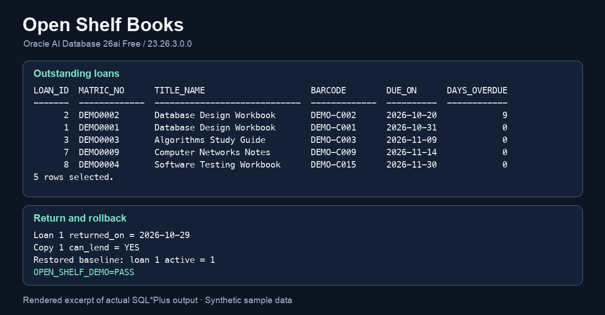

# Oracle demonstration

[中文](#演示) · [Quick start](../README.md#quick-start)

Run this after loading the synthetic fixture using the setup instructions.

```sh
./scripts/oracle.sh demo
```

With an existing Oracle connection opened from the repository root, run `@db/05_demo.sql` in SQL*Plus or SQLcl. The script shows three reporting queries and one rollback-only API mutation.

| Step | What to look for in the baseline fixture |
| --- | --- |
| Q1 · Outstanding and overdue loans | Five open loans. Comparing due dates with the demo cutoff of `2026-10-29` yields one loan overdue by nine days. |
| Q2 · Title popularity | Ten title rows. `Database Design Workbook` has three total loans and two open loans. |
| Q3 · Unmet reservations | Two titles with waiting members and no lendable copy. `Database Design Workbook` has two waiting members and `Computer Networks Notes` has one. |
| Q4 · Return and restore | Loan 1 receives `returned_on = 2026-10-29`. Copy 1 becomes lendable. Rolling back makes loan 1 open again. |

The verified baseline has 11 tables and 12 foreign keys. There are 10 titles, 20 copies, 9 members, 8 loan rows, 5 open loans, 3 active reservations, and 13 lendable copies. All names, identifiers, ISBNs, and dates in the demo are synthetic fixtures. The selected cutoff is a test input.

The bundled output was recorded in a fresh `OPEN_SHELF_BOOKS_TEST` schema on Oracle AI Database 26ai Free `23.26.3.0.0`. The image renders the outstanding-loan and return sections of that run.



[Full SQL*Plus output](oracle-demo.txt) · [Demo SQL](../db/05_demo.sql) · [Runtime checks](../tests/04_runtime.sql)

## 演示

[English](#oracle-demonstration) · [快速启动](../README.zh-CN.md#快速启动)

按快速启动说明加载合成样本后，在仓库根目录运行：

```sh
./scripts/oracle.sh demo
```

已有 Oracle 连接时，可从仓库根目录启动 SQL*Plus 或 SQLcl，然后执行 `@db/05_demo.sql`。演示包括三个报表查询和一个执行后回滚的接口操作。

| 步骤 | 初始样本中的实测结果 |
| --- | --- |
| Q1 · 未归还与逾期借阅 | 有五条未归还借阅。以 `2026-10-29` 为计算基准，有一条逾期九天。 |
| Q2 · 书目借阅量 | 共十个书目。`Database Design Workbook` 有三条借阅记录，其中两条未归还。 |
| Q3 · 未满足预约 | 两个书目有等待会员且无可借副本。`Database Design Workbook` 有两人等待，`Computer Networks Notes` 有一人等待。 |
| Q4 · 归还与恢复 | 借阅 1 的 `returned_on` 写为 `2026-10-29`，副本 1 恢复可借。回滚后，借阅 1 恢复为未归还。 |

初始样本有 11 张表、12 个外键、10 个书目、20 个副本、9 位会员、8 条借阅、5 条未归还借阅、3 条有效预约及 13 个可借副本。姓名、标识、ISBN 和日期均为合成样本。所选统计日期是测试输入。

随附输出来自 Oracle AI Database 26ai Free `23.26.3.0.0` 中新建的 `OPEN_SHELF_BOOKS_TEST` schema。上图呈现实测输出中的未归还借阅及归还回滚两部分。

[完整 SQL*Plus 输出](oracle-demo.txt) · [演示 SQL](../db/05_demo.sql) · [运行检查](../tests/04_runtime.sql)
