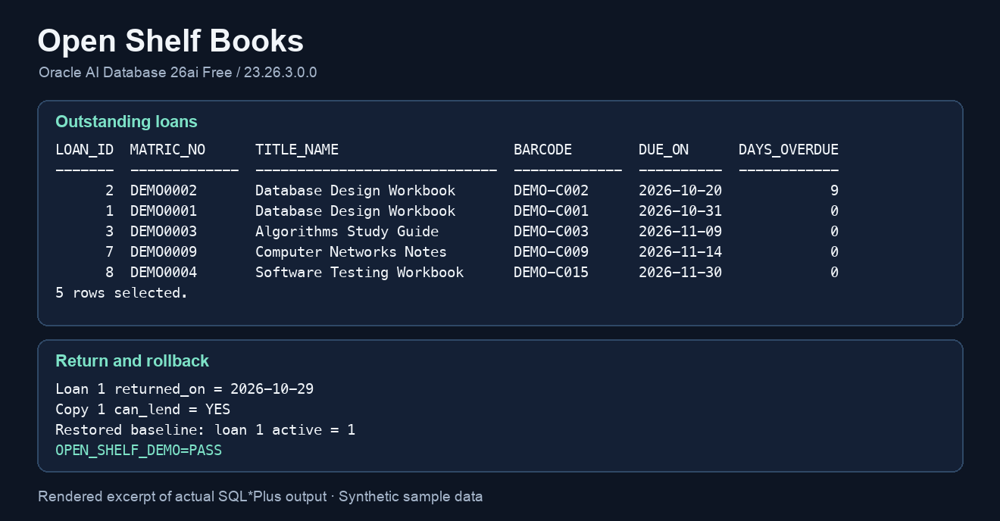

# Oracle demonstration

[Quick start](../README.md#quick-start)

Run this after loading the synthetic fixture using the setup instructions.

```sh
python3 scripts/oracle.py demo
```

With an existing Oracle connection opened from the repository root, run `@db/05_demo.sql` in SQL*Plus or SQLcl. The script shows three reporting queries and one rollback-only API mutation.

| Step | What to look for in the baseline fixture |
| --- | --- |
| Q1 · Outstanding and overdue loans | Five open loans. Comparing due dates with the demo cutoff of `2026-10-29` yields one loan overdue by nine days. |
| Q2 · Title popularity | Ten title rows. `Database Design Workbook` has three total loans and two open loans. |
| Q3 · Unmet reservations | Two titles with waiting members and no lendable copy. `Database Design Workbook` has two waiting members and `Computer Networks Notes` has one. |
| Q4 · Return and restore | Loan 1 receives `returned_on = 2026-10-29`. Copy 1 becomes lendable. Rolling back makes loan 1 open again. |

The verified baseline has 11 tables and 12 foreign keys. There are 10 titles, 20 copies, 9 members, 8 loan rows, 5 open loans, 3 active reservations, and 13 lendable copies. All names, identifiers, ISBNs, and dates in the demo are synthetic fixtures. The selected cutoff is a test input.

The bundled output was recorded in a fresh `OPEN_SHELF_BOOKS_TEST` schema on Oracle AI Database 26ai Free `23.26.3.0.0`. The image renders the outstanding-loan and return sections of that run.



[Full SQL*Plus output](oracle-demo.txt) · [Demo SQL](../db/05_demo.sql) · [Runtime checks](../tests/04_runtime.sql)
