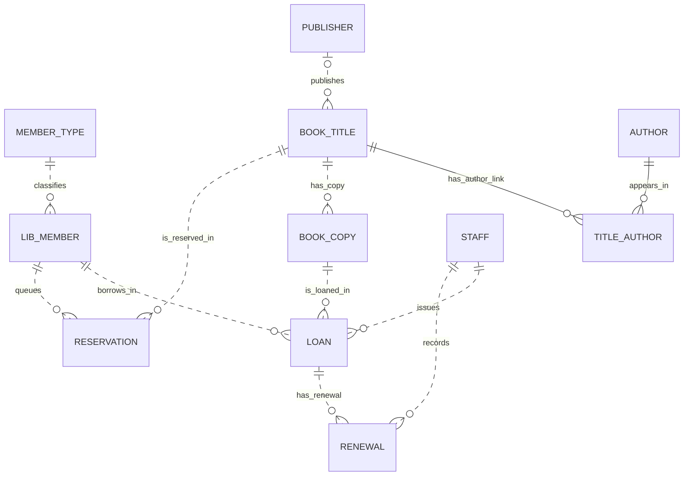

# Schema and entity relationships

[中文说明](#中文说明) · [Design and policies](design.md) · [Oracle DDL](../db/01_schema.sql)

The model has **11 tables and 12 foreign keys**. A title describes the edition. A copy describes one physical item. Loans, renewals and reservations record events separately from the catalog. A title may have an unknown publisher and can exist before any author links or copies are added.

## ERD

Solid edges identify the association rows in `TITLE_AUTHOR`. Dotted edges represent foreign keys outside the child primary key. / 实线表示外键同时构成 `TITLE_AUTHOR` 的主键，虚线表示外键不参与子表主键。

## Integrity and normalization

- A primary key identifies each row. `TITLE_AUTHOR` uses `(title_id, author_id)`. The other tables use numeric identity keys. Seed IDs are below 1000 and generated IDs begin at 1000.
- The foreign keys reference the matching parent table. Referenced rows cannot be removed while dependent rows exist. `BOOK_TITLE.publisher_id` is the only optional foreign key.
- Member number and email, staff email, category name and copy barcode are unique. ISBN is unique when provided. Catalog publishers and authors have separate IDs, so their display names can repeat.
- Copies store `AVAILABLE`, `REPAIR` or `LOST`. The availability view considers open loans separately. Members store `ACTIVE` or `SUSPENDED`. Reservations are `ACTIVE`, `FULFILLED` or `CANCELLED`. Active reservations have no closure time and closed reservations must have one.
- Loan due dates must follow checkout. Returns must be on or after checkout. Each renewal moves the due date forward. The package also validates event chronology across rows.
- Function-based unique indexes cover open loans per copy and active reservations per member/title. These indexes enforce the condition while preserving closed history.
- Member policies, bibliographic titles, physical inventory and circulation events have separate determinants. A loan preserves its due date, and each renewal preserves the previous and new values. The schema derives availability and overdue days instead of storing them on copies.

## Field dictionary

`PK` is primary key, `FK` is foreign key, and `UQ` is unique. Oracle `DATE` stores date and time. The field identifiers below match the SQL.

### MEMBER_TYPE · 会员类型

Borrowing limits, duration and renewal cap for one member category. 保存一个会员类别的借阅上限、借期及续借次数。

| Field | Oracle type | Nullable | Key | Description / 中文 |
| --- | --- | --- | --- | --- |
| `member_type_id` | `NUMBER(10)` | No | PK | Member category ID / 会员类型编号 |
| `type_name` | `VARCHAR2(40)` | No | UQ | Category name / 类型名称 |
| `loan_limit` | `NUMBER(3)` | No | — | Maximum simultaneously open loans / 借阅数量上限 |
| `loan_days` | `NUMBER(3)` | No | — | Length of a borrowing period in days / 借阅天数 |
| `max_renewals` | `NUMBER(2)` | No | — | Maximum renewals per loan / 续借次数上限 |

### LIB_MEMBER · 图书馆会员

A library borrower and the borrower’s current eligibility. 保存借阅者及其当前资格。

| Field | Oracle type | Nullable | Key | Description / 中文 |
| --- | --- | --- | --- | --- |
| `member_id` | `NUMBER(10)` | No | PK | Member ID / 会员编号 |
| `matric_no` | `VARCHAR2(20)` | No | UQ | Student membership identifier / 学号 |
| `full_name` | `VARCHAR2(100)` | No | — | Member name / 姓名 |
| `email` | `VARCHAR2(254)` | No | UQ | Email address / 邮箱 |
| `member_type_id` | `NUMBER(10)` | No | FK MEMBER_TYPE | Member category ID / 会员类型编号 |
| `expires_on` | `DATE` | No | — | Last eligible calendar day / 会员到期日 |
| `status` | `VARCHAR2(10)` | No | — | Membership status / 会员状态 |

### STAFF · 职员

The staff identity attributed to checkout and renewal. 记录办理借出和续借的职员身份。

| Field | Oracle type | Nullable | Key | Description / 中文 |
| --- | --- | --- | --- | --- |
| `staff_id` | `NUMBER(10)` | No | PK | Staff ID / 职员编号 |
| `staff_name` | `VARCHAR2(100)` | No | — | Staff name / 职员姓名 |
| `email` | `VARCHAR2(254)` | No | UQ | Email address / 邮箱 |

### PUBLISHER · 出版社

Optional publisher catalog information. 保存书目的可选出版社信息。

| Field | Oracle type | Nullable | Key | Description / 中文 |
| --- | --- | --- | --- | --- |
| `publisher_id` | `NUMBER(10)` | No | PK | Publisher ID / 出版社编号 |
| `publisher_name` | `VARCHAR2(120)` | No | — | Publisher name / 出版社名称 |

### BOOK_TITLE · 书目

A bibliographic edition that can have many physical copies. 每条书目表示一个版本，可对应多个实体副本。

| Field | Oracle type | Nullable | Key | Description / 中文 |
| --- | --- | --- | --- | --- |
| `title_id` | `NUMBER(10)` | No | PK | Bibliographic title ID / 书目编号 |
| `isbn` | `VARCHAR2(13)` | Yes | UQ | 13-digit ISBN, when known / ISBN |
| `title_name` | `VARCHAR2(200)` | No | — | Title as catalogued / 书名 |
| `publisher_id` | `NUMBER(10)` | Yes | FK PUBLISHER | Publisher ID / 出版社编号 |
| `publication_year` | `NUMBER(4)` | Yes | — | Edition’s publication year / 出版年 |

### AUTHOR · 作者

Author identity shared across titles. 保存可关联多个书目的作者。

| Field | Oracle type | Nullable | Key | Description / 中文 |
| --- | --- | --- | --- | --- |
| `author_id` | `NUMBER(10)` | No | PK | Author ID / 作者编号 |
| `author_name` | `VARCHAR2(100)` | No | — | Author name / 作者姓名 |

### TITLE_AUTHOR · 书目作者关联

Many-to-many authorship. The two foreign keys form the primary key. 保存多对多著者关系，两个外键合成主键。

| Field | Oracle type | Nullable | Key | Description / 中文 |
| --- | --- | --- | --- | --- |
| `title_id` | `NUMBER(10)` | No | PK FK BOOK_TITLE | Bibliographic title ID / 书目编号 |
| `author_id` | `NUMBER(10)` | No | PK FK AUTHOR | Author ID / 作者编号 |

### BOOK_COPY · 馆藏副本

One barcoded physical item, its shelf and its physical condition. 保存带条码的实体副本、书架和实体状态。

| Field | Oracle type | Nullable | Key | Description / 中文 |
| --- | --- | --- | --- | --- |
| `copy_id` | `NUMBER(10)` | No | PK | Physical copy ID / 副本编号 |
| `barcode` | `VARCHAR2(30)` | No | UQ | Barcode unique to the copy / 条码 |
| `title_id` | `NUMBER(10)` | No | FK BOOK_TITLE | Bibliographic title ID / 书目编号 |
| `shelf_code` | `VARCHAR2(30)` | No | — | Shelf location code / 书架代码 |
| `copy_status` | `VARCHAR2(10)` | No | — | Physical condition / 副本实体状态 |

### LOAN · 借阅

One checkout of one copy to one member. A null return time marks an open loan. 一次借阅对应一个副本和一位会员。归还时间为空表示尚未归还。

| Field | Oracle type | Nullable | Key | Description / 中文 |
| --- | --- | --- | --- | --- |
| `loan_id` | `NUMBER(10)` | No | PK | Checkout event ID / 借阅编号 |
| `copy_id` | `NUMBER(10)` | No | FK BOOK_COPY | Physical copy ID / 副本编号 |
| `member_id` | `NUMBER(10)` | No | FK LIB_MEMBER | Member ID / 会员编号 |
| `staff_id` | `NUMBER(10)` | No | FK STAFF | Staff member who recorded the checkout / 职员编号 |
| `borrowed_on` | `DATE` | No | — | Checkout date and time / 借出时间 |
| `due_on` | `DATE` | No | — | Current due date and time / 当前到期时间 |
| `returned_on` | `DATE` | Yes | — | Return date and time, null while open / 归还时间 |

### RENEWAL · 续借事件

One due-date extension and its before/after dates. 保存一次续借及变更前后的到期日。

| Field | Oracle type | Nullable | Key | Description / 中文 |
| --- | --- | --- | --- | --- |
| `renewal_id` | `NUMBER(10)` | No | PK | Renewal event ID / 续借编号 |
| `loan_id` | `NUMBER(10)` | No | FK LOAN | Checkout event ID / 借阅编号 |
| `staff_id` | `NUMBER(10)` | No | FK STAFF | Staff member who recorded the renewal / 职员编号 |
| `renewed_on` | `DATE` | No | — | Renewal date and time / 续借时间 |
| `previous_due_on` | `DATE` | No | — | Due date before the renewal / 原到期时间 |
| `new_due_on` | `DATE` | No | — | Due date after the renewal / 新到期时间 |

### RESERVATION · 预约

A member’s place in the title queue and any closure. 保存会员的书目预约及其关闭结果。

| Field | Oracle type | Nullable | Key | Description / 中文 |
| --- | --- | --- | --- | --- |
| `reservation_id` | `NUMBER(10)` | No | PK | Reservation ID / 预约编号 |
| `title_id` | `NUMBER(10)` | No | FK BOOK_TITLE | Bibliographic title ID / 书目编号 |
| `member_id` | `NUMBER(10)` | No | FK LIB_MEMBER | Member ID / 会员编号 |
| `reserved_on` | `DATE` | No | — | Time entered into the queue / 预约时间 |
| `reservation_status` | `VARCHAR2(10)` | No | — | Queue status / 预约状态 |
| `closed_on` | `DATE` | Yes | — | Fulfillment or cancellation time / 关闭时间 |

## 中文说明

[English](#schema-and-entity-relationships) · [ERD](#erd) · [字段字典](#field-dictionary) · [设计与规则](design.md#设计与规则)

数据库包含 **11 张表和 12 个外键**。书目表示图书版本，副本表示实体图书。借阅、续借及预约以独立事件记录。书目可以暂缺出版社，也可以先录入书目，再添加作者关联和副本。

主键标识记录。`TITLE_AUTHOR` 以 `(title_id, author_id)` 为复合主键，其余表使用数字标识。样本 ID 小于 1000，自动生成的 ID 从 1000 起。`BOOK_TITLE.publisher_id` 是唯一可空的外键。有子记录引用时，父记录不能删除。学号和会员邮箱、职员邮箱、类别名、副本条码均唯一。ISBN 有值时必须唯一。

副本状态为 `AVAILABLE`、`REPAIR` 或 `LOST`。数据库结合未归还借阅判断是否可借。会员状态为 `ACTIVE` 或 `SUSPENDED`。预约状态为 `ACTIVE`、`FULFILLED` 或 `CANCELLED`。有效预约没有关闭时间，已关闭预约必须有关闭时间。到期时间晚于借出时间，归还时间不得早于借出，续借后的到期时间必须晚于原到期时间。跨记录的时间顺序由流通包检查。

基于函数的唯一索引约束每个副本最多一条未归还借阅，同一会员对同一书目最多一条有效预约。会员类别、书目、实体副本与流通事件分表存储。借阅记录当前到期日，续借事件保留原值和新值。可借性和逾期天数由查询计算。

字段表中的 `Nullable` 表示字段是否可空，`PK` 为主键、`FK` 为外键、`UQ` 为唯一约束。Oracle `DATE` 同时保存日期和时间。
