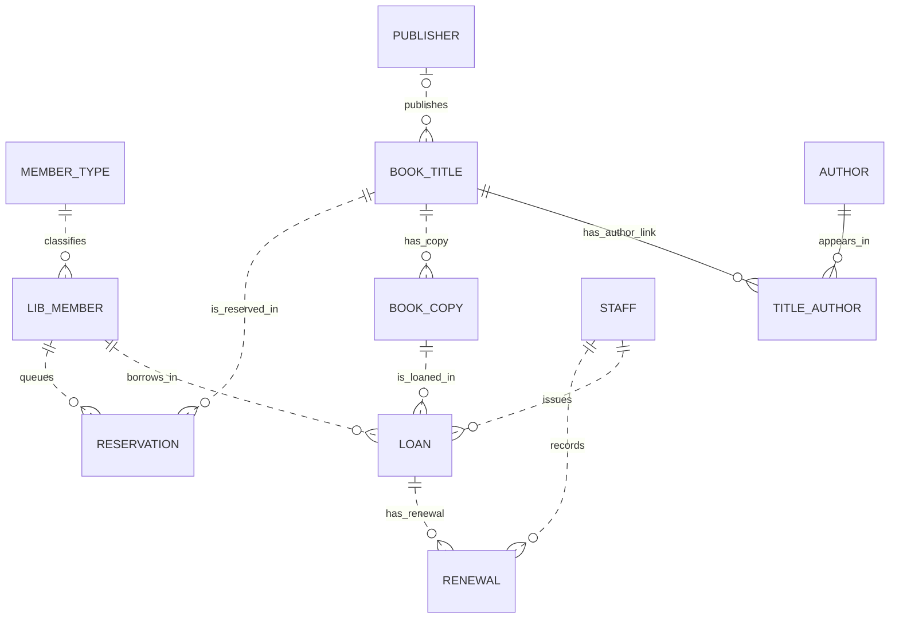

# Schema and entity relationships

[Design and policies](design.md) · [Oracle DDL](../db/01_schema.sql)

The model has **11 tables and 12 foreign keys**. A title describes the edition. A copy describes one physical item. Loans, renewals and reservations record events separately from the catalog. A title may have an unknown publisher and can exist before any author links or copies are added.

## ERD

Solid edges identify the association rows in `TITLE_AUTHOR`. Dotted edges represent foreign keys outside the child primary key.

## Integrity and normalization

- A primary key identifies each row. `TITLE_AUTHOR` uses `(title_id, author_id)`. The other tables use numeric identity keys. Seed IDs are below 1000 and generated IDs begin at 1000.
- The foreign keys reference the matching parent table. Referenced rows cannot be removed while dependent rows exist. `BOOK_TITLE.publisher_id` is the only optional foreign key.
- Member number and email, staff email, category name and copy barcode are unique. ISBN is unique when provided. Catalog publishers and authors have separate IDs, so their display names can repeat.
- Copies store `AVAILABLE`, `REPAIR` or `LOST`. The availability view considers open loans separately. Members store `ACTIVE` or `SUSPENDED`. Reservations are `ACTIVE`, `FULFILLED` or `CANCELLED`. Active reservations have no closure time and closed reservations must have one.
- Loan due dates must follow checkout. Returns must be on or after checkout. Each renewal moves the due date forward. The package also validates event chronology across rows.
- Function-based unique indexes cover open loans per copy and active reservations per member/title. These indexes enforce the condition while preserving closed history.
- Member policies, bibliographic titles, physical inventory and circulation events have separate determinants. A loan preserves its due date, and each renewal preserves the previous and new values. The schema derives availability and overdue days instead of storing them on copies.

## Field dictionary

`PK` is primary key, `FK` is foreign key, and `UQ` is unique. Oracle `DATE` stores date and time. The field identifiers below match the SQL.

### MEMBER_TYPE

Borrowing limits, duration and renewal cap for one member category.

| Field | Oracle type | Nullable | Key | Description |
| --- | --- | --- | --- | --- |
| `member_type_id` | `NUMBER(10)` | No | PK | Member category ID |
| `type_name` | `VARCHAR2(40)` | No | UQ | Category name |
| `loan_limit` | `NUMBER(3)` | No | — | Maximum simultaneously open loans |
| `loan_days` | `NUMBER(3)` | No | — | Length of a borrowing period in days |
| `max_renewals` | `NUMBER(2)` | No | — | Maximum renewals per loan |

### LIB_MEMBER

A library borrower and the borrower’s current eligibility.

| Field | Oracle type | Nullable | Key | Description |
| --- | --- | --- | --- | --- |
| `member_id` | `NUMBER(10)` | No | PK | Member ID |
| `matric_no` | `VARCHAR2(20)` | No | UQ | Student membership identifier |
| `full_name` | `VARCHAR2(100)` | No | — | Member name |
| `email` | `VARCHAR2(254)` | No | UQ | Email address |
| `member_type_id` | `NUMBER(10)` | No | FK MEMBER_TYPE | Member category ID |
| `expires_on` | `DATE` | No | — | Last eligible calendar day |
| `status` | `VARCHAR2(10)` | No | — | Membership status |

### STAFF

The staff identity attributed to checkout and renewal.

| Field | Oracle type | Nullable | Key | Description |
| --- | --- | --- | --- | --- |
| `staff_id` | `NUMBER(10)` | No | PK | Staff ID |
| `staff_name` | `VARCHAR2(100)` | No | — | Staff name |
| `email` | `VARCHAR2(254)` | No | UQ | Email address |

### PUBLISHER

Optional publisher catalog information.

| Field | Oracle type | Nullable | Key | Description |
| --- | --- | --- | --- | --- |
| `publisher_id` | `NUMBER(10)` | No | PK | Publisher ID |
| `publisher_name` | `VARCHAR2(120)` | No | — | Publisher name |

### BOOK_TITLE

A bibliographic edition that can have many physical copies.

| Field | Oracle type | Nullable | Key | Description |
| --- | --- | --- | --- | --- |
| `title_id` | `NUMBER(10)` | No | PK | Bibliographic title ID |
| `isbn` | `VARCHAR2(13)` | Yes | UQ | 13-digit ISBN, when known / ISBN |
| `title_name` | `VARCHAR2(200)` | No | — | Title as catalogued |
| `publisher_id` | `NUMBER(10)` | Yes | FK PUBLISHER | Publisher ID |
| `publication_year` | `NUMBER(4)` | Yes | — | Edition’s publication year |

### AUTHOR

Author identity shared across titles.

| Field | Oracle type | Nullable | Key | Description |
| --- | --- | --- | --- | --- |
| `author_id` | `NUMBER(10)` | No | PK | Author ID |
| `author_name` | `VARCHAR2(100)` | No | — | Author name |

### TITLE_AUTHOR

Many-to-many authorship. The two foreign keys form the primary key.

| Field | Oracle type | Nullable | Key | Description |
| --- | --- | --- | --- | --- |
| `title_id` | `NUMBER(10)` | No | PK FK BOOK_TITLE | Bibliographic title ID |
| `author_id` | `NUMBER(10)` | No | PK FK AUTHOR | Author ID |

### BOOK_COPY

One barcoded physical item, its shelf and its physical condition.

| Field | Oracle type | Nullable | Key | Description |
| --- | --- | --- | --- | --- |
| `copy_id` | `NUMBER(10)` | No | PK | Physical copy ID |
| `barcode` | `VARCHAR2(30)` | No | UQ | Barcode unique to the copy |
| `title_id` | `NUMBER(10)` | No | FK BOOK_TITLE | Bibliographic title ID |
| `shelf_code` | `VARCHAR2(30)` | No | — | Shelf location code |
| `copy_status` | `VARCHAR2(10)` | No | — | Physical condition |

### LOAN

One checkout of one copy to one member. A null return time marks an open loan.

| Field | Oracle type | Nullable | Key | Description |
| --- | --- | --- | --- | --- |
| `loan_id` | `NUMBER(10)` | No | PK | Checkout event ID |
| `copy_id` | `NUMBER(10)` | No | FK BOOK_COPY | Physical copy ID |
| `member_id` | `NUMBER(10)` | No | FK LIB_MEMBER | Member ID |
| `staff_id` | `NUMBER(10)` | No | FK STAFF | Staff member who recorded the checkout |
| `borrowed_on` | `DATE` | No | — | Checkout date and time |
| `due_on` | `DATE` | No | — | Current due date and time |
| `returned_on` | `DATE` | Yes | — | Return date and time, null while open |

### RENEWAL

One due-date extension and its before/after dates.

| Field | Oracle type | Nullable | Key | Description |
| --- | --- | --- | --- | --- |
| `renewal_id` | `NUMBER(10)` | No | PK | Renewal event ID |
| `loan_id` | `NUMBER(10)` | No | FK LOAN | Checkout event ID |
| `staff_id` | `NUMBER(10)` | No | FK STAFF | Staff member who recorded the renewal |
| `renewed_on` | `DATE` | No | — | Renewal date and time |
| `previous_due_on` | `DATE` | No | — | Due date before the renewal |
| `new_due_on` | `DATE` | No | — | Due date after the renewal |

### RESERVATION

A member’s place in the title queue and any closure.

| Field | Oracle type | Nullable | Key | Description |
| --- | --- | --- | --- | --- |
| `reservation_id` | `NUMBER(10)` | No | PK | Reservation ID |
| `title_id` | `NUMBER(10)` | No | FK BOOK_TITLE | Bibliographic title ID |
| `member_id` | `NUMBER(10)` | No | FK LIB_MEMBER | Member ID |
| `reserved_on` | `DATE` | No | — | Time entered into the queue |
| `reservation_status` | `VARCHAR2(10)` | No | — | Queue status |
| `closed_on` | `DATE` | Yes | — | Fulfillment or cancellation time |
